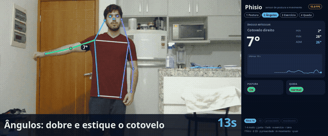
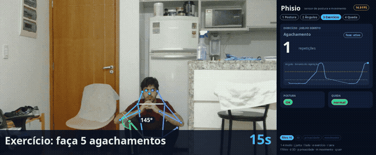
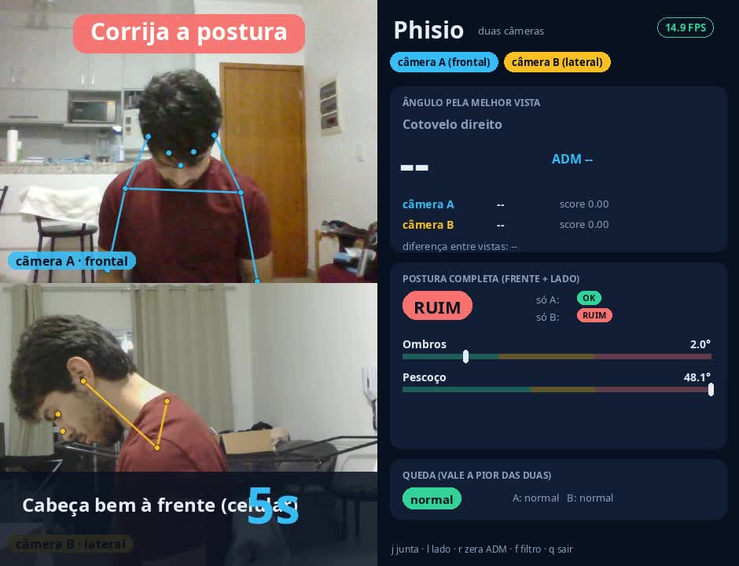
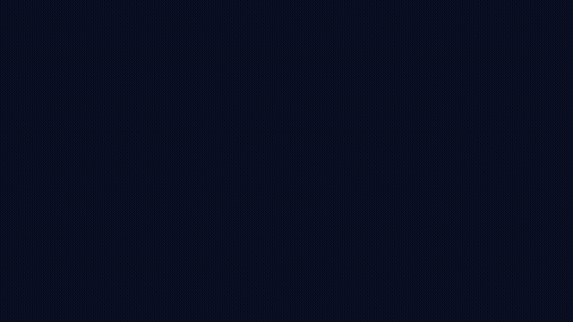
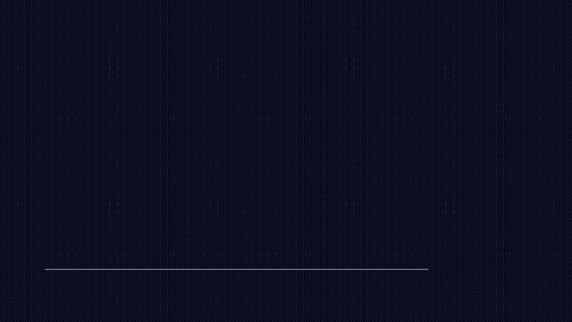
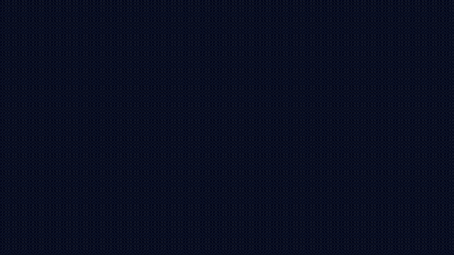

# Phisio

Sensor de postura e de ângulo das articulações usando só uma webcam (ou duas).
Trabalho TP01 de **SSC0715 Sensores Inteligentes** (ICMC/USP, 2026), feito por Davi Araújo.



## Por que eu fiz isso

A ideia veio da minha própria fisioterapia. A clínica onde eu faço usa um software que custou uns
**US$ 10 mil** de licença vitalícia, e ele funciona com sensores com fio (provavelmente IMUs) colados
nas articulações do paciente. Funciona bem, mas é caro e demora pra montar.

Eu queria ver até onde dá pra chegar com uma webcam comum e ferramentas abertas (Python, OpenCV,
PyTorch e os modelos YOLO26 da Ultralytics). O resultado é o Phisio: ele acha o corpo na imagem,
filtra os pontos, calcula ângulos e decide coisas como "postura ruim há 5 s" ou "isso foi uma queda".

## O que ele faz

| modo | o que mede |
|---|---|
| **Postura** | classifica OK / atenção / ruim pela inclinação do pescoço, do tronco e dos ombros |
| **Ângulos** | ângulo de uma articulação (cotovelo, joelho, quadril, ombro) e amplitude de movimento (ADM) |
| **Exercício** | conta repetições com uma máquina de estados (agachamento, rosca bíceps, elevação lateral) |
| **Queda** | detecta queda e diferencia de só deitar ou sentar |

Com **duas câmeras** (uma de frente e uma de lado) ele junta as duas vistas: cada articulação usa a
câmera que vê melhor o membro, e a postura fica completa (ombros pela frente, pescoço pelo lado).

<p align="center">
  
  
</p>

Na imagem da direita dá pra ver o motivo das duas câmeras: de frente a postura parece OK, mas a
câmera lateral mostra o pescoço a 48° e o sistema dispara o alerta.

## Como funciona

```
webcam (~30 Hz)
  → YOLO26-pose: 17 keypoints com confiança            (detecção)
  → gate de confiança + filtro 1€                      (filtragem)
  → ângulos 2D/3D, inclinações, velocidade do quadril  (extração de características)
  → limiares + tempo (debounce, histerese, janelas)    (decisão)
  → painel, alertas, log CSV por quadro, relatório
```

Opcionais: YOLO26-seg borra tudo menos a pessoa (privacidade), YOLO26-depth estima profundidade
para os ângulos em 3D e o MOG2 do OpenCV serve de baseline clássico de detecção de movimento.

### Ângulo a partir de três pontos

Com ombro A, cotovelo B e punho C, o ângulo sai do produto escalar:

θ = arccos( BA·BC / (|BA| |BC|) ), e a flexão reportada é 180° − θ

Assim o braço esticado lê 0°, que é a convenção que fisioterapeutas usam. A mesma conta vale para
pontos 3D. Para postura, uso o ângulo do segmento quadril→ombro (tronco) e ombro→orelha (pescoço)
em relação à vertical.



### 2D → 3D

O YOLO26-depth dá uma profundidade Z por pixel. Com o modelo pinhole e a distância focal estimada
pelo campo de visão da webcam (f = (W/2)/tan(FOV/2)), cada keypoint vira um ponto 3D:
X = (u − cx)·Z/f, Y = (v − cy)·Z/f. Pego a mediana de uma janela 9×9 em volta do keypoint.

### Filtro 1€

Os keypoints tremem mesmo com a pessoa parada. Testei cinco filtros nos mesmos dados (meu cotovelo
parado, depois seis flexões rápidas, depois parado de novo):



| filtro | tremor parado | atraso | ADM medida |
|---|---|---|---|
| sem filtro | 1,1° | 0 ms | 145° |
| média móvel (10) | 0,6° | 236 ms | **91°** |
| exponencial (α = 0,15) | 0,6° | 118 ms | **91°** |
| Kalman (velocidade constante) | 0,8° | 118 ms | 133° |
| **1€** | 0,7° | **59 ms** | **139°** |

Média móvel e exponencial tiram o tremor, mas cortam o pico do movimento: a amplitude cai de 145°
para 91°, e amplitude é justamente o que o fisioterapeuta quer medir. O
[filtro 1€](https://gery.casiez.net/1euro/) (Casiez et al., CHI 2012) é um passa-baixa em que a
frequência de corte aumenta com a velocidade, então ele suaviza parado e quase não atrasa no
movimento. Um Kalman também resolveria, mas precisa de modelo e de ajuste das covariâncias (no meu
teste ele passou do valor real nas transições). A ideia da comparação veio da
[demo interativa oficial](https://gery.casiez.net/1euro/InteractiveDemo/).

Para reproduzir: `uv run python -m eval.filter_compare sessions/<sessao>.csv --joint cotovelo_D`

### Decisão

- **Postura:** limiares de atenção/ruim por métrica (pescoço 20°/30°, tronco 10°/20°, ombros 3°/6°).
  Um estado novo só vale se durar 1 s, e o alerta só aparece depois de 5 s em "ruim".
- **Repetições:** dois limiares (histerese), então ruído perto de um limiar não conta repetição falsa.
- **Queda:** precisa de três coisas em sequência: o quadril desce rápido (> 0,8 alturas do corpo
  por segundo), o tronco fica horizontal (> 60°) e a pessoa fica parada 2 s. Deitar devagar vira
  "deitado", sem alarme. Sentar rápido numa cadeira também não dispara (no meu teste o pico foi
  0,43 alturas/s).

## Por que duas câmeras



Uma câmera só vê o movimento projetado no plano da imagem. Quando eu sentei de frente para o
notebook e levei a cabeça para frente, a cabeça foi na direção da lente e o sistema não viu nada
(32% de acurácia, praticamente chute). Tentei resolver com o YOLO26-depth: a diferença de
profundidade entre cabeça e ombro teve ruído de ±8 a 16 cm, maior que o próprio movimento.

Com uma segunda câmera de lado, cada métrica vem da vista certa:

- **ângulo pela melhor vista:** score = confiança × comprimento do membro ÷ tronco, e usa a câmera
  com o maior score (a que vê o membro menos encurtado);
- **postura completa:** a frontal mede ombros e inclinação lateral, a lateral mede pescoço e tronco;
- **queda redundante:** vale o estado mais grave entre as duas câmeras.

## Resultados

Tudo medido no meu notebook (Ryzen 7 5800H + GTX 1650) com uma webcam de notebook (720p) e uma
Logitech Brio 100 (1080p).

### Desempenho

| modelo | GTX 1650 (FPS) | só CPU, Ryzen 7 5800H (FPS) |
|---|---|---|
| yolo26n-pose | 65 | 32 |
| yolo26s-pose | 50 | 14 |
| yolo26n-depth | 34 | 7 |
| yolo26n-seg | 92 | 30 |

O modelo de pose roda mais rápido que a própria webcam (30 Hz) mesmo sem GPU. No uso real, com
gravação de vídeo e painel, ficou em ~15–20 FPS, limitado pela câmera em ambiente com pouca luz.
`uv run python -m eval.bench --source 0`

### Postura com duas câmeras

Sessão guiada de ~3 min: o programa mostra na tela "sente reto", "cabeça um pouco à frente" e
"cabeça bem à frente" (três rodadas) e grava o rótulo verdadeiro sozinho. Desconsiderando os 2 s
depois de cada troca:

| | só frontal | só lateral | as duas |
|---|---|---|---|
| acurácia | 27% | **77%** | 71% |

A câmera lateral é a que enxerga a cabeça indo para frente. A fusão ficou um pouco abaixo dela
porque é conservadora (vale o pior caso) e herdou alarmes falsos de ombro da câmera frontal (o
limiar de 3°/6° é apertado). Eu não reajustei os limiares nesses mesmos dados para não inflar o
resultado; calibrar por paciente e dar peso por métrica na fusão fica para a próxima versão.
`uv run python -m eval.posture_eval sessions/multicam_<data>.csv`

### Ângulo

Checagem pontual com o cotovelo apoiado no canto de um livro (90°): o sistema mediu 89,6° e 89,5°
nas duas fotos. São só duas fotos, então isso é uma checagem e não uma validação. O protocolo para
uma medição de verdade está em `eval/angle_eval.py` (e `eval/capture_angles.py` tira as fotos).

### Testes

`uv run python -m pytest -q` roda 9 testes com esqueletos sintéticos: geometria, níveis de postura e
debounce, vista frontal sem quadril, contador de repetições, ADM ignorando falha de um quadro,
queda × deitar e a fusão de duas câmeras.

## Como rodar

Precisa de Python 3.12 e do [uv](https://docs.astral.sh/uv/).

```bash
git clone https://github.com/Davi-nAraujo/phisio && cd phisio
uv sync                                    # instala PyTorch, Ultralytics, OpenCV...
uv run python -m phisio.app --mirror       # webcam 0
uv run python -m phisio.app --source 2     # outra webcam (no Linux a segunda costuma ser 2)
uv run python -m phisio.multicam --sources 0 2
```

Sem GPU NVIDIA ele roda na CPU automaticamente.

**Teclas:** `1-4` modo · `j` troca a articulação · `l` lado · `e` exercício · `r` zera ADM e
repetições · `f` liga/desliga o filtro · `d` 3D · `p` privacidade · `m` máscara de movimento ·
`7/8/9` rótulo real da postura · `q` sair.

**Sessões guiadas** (instruções grandes na tela, sem precisar do teclado):
`--guide postura` (teste de postura rotulado), `--guide demo` (passa pelos quatro modos).
Com `--record` ele salva o vídeo junto do log em `sessions/`. Depois,
`uv run python -m phisio.report sessions/sessao_<data>.csv` gera os gráficos da sessão.

## Estrutura

```
phisio/   app.py (uma câmera), multicam.py (duas), engines.py (modelos), filters.py,
          geometry.py, analyzers.py (decisões), fusion.py, ui.py, report.py
eval/     bench.py, filter_compare.py, posture_eval.py, angle_eval.py, capture_angles.py
docs/     imagens, GIFs e as animações (anim/scenes.py, feitas com Manim)
tests/    testes da lógica
legacy/   meu protótipo de janeiro (uma articulação, MediaPipe × YOLOv8)
```

## Limitações e próximos passos

- Os limiares de postura são heurísticos e precisam ser calibrados com um fisioterapeuta.
- O ângulo 2D erra quando o movimento sai do plano da imagem, e a profundidade monocular é ruidosa.
- Uma pessoa por vez.
- A validação do ângulo ainda é pequena.

Próximo passo natural: calibrar as duas câmeras em estéreo (tabuleiro de xadrez,
`cv2.stereoCalibrate`) e triangular os keypoints (`cv2.triangulatePoints`) para ter 3D métrico de
verdade, e comparar com o instrumento da clínica junto com a minha fisioterapeuta.

## Créditos

- Filtro 1€: Casiez, Roussel e Vogel, *1€ Filter: A Simple Speed-based Low-pass Filter for Noisy
  Input in Interactive Systems*, CHI 2012. Implementação oficial (BSD) em `phisio/one_euro_filter.py`.
- Modelos YOLO26 (pose, seg, depth): [Ultralytics](https://github.com/ultralytics/ultralytics).
- Animações: [Manim Community](https://www.manim.community).
